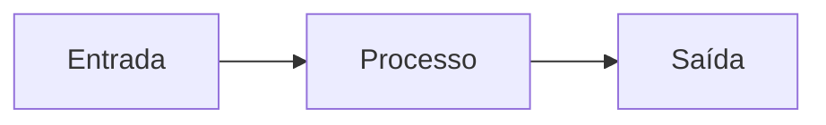

# Linha de Comando

**O que entra:** programação: código, ferramentas, scripts, diagramas e explicações técnicas do que acontece por baixo do capô.

**Tom:** didático e direto, primeira pessoa, curiosidade de quem abriu o capô. Explica o porquê antes do como; sem jargão gratuito e sem pose de tutorial.

**Tamanho e estrutura:** 300 a 900 palavras. Abertura com o problema ou a pergunta, desenvolvimento em blocos curtos (texto, código ou diagrama, comentário), fecho com o que se aprendeu ou o que fica em aberto.

**Elementos ricos:** bloco de código com linguagem (```python, ```bash), ```mermaid para fluxos e arquiteturas, fórmulas com `$$...$$`, tabelas para comparações, `{: .tip}` para dica prática e `{: .warn}` para armadilha, `` para referências.

**Front matter:** `title`, `description` e `tags` obrigatórios. Tags típicas: código, ferramentas, scripts, redes, diagramas. A `description` diz o que o leitor vai entender.

**Não confundir:** achado ou ferramenta comentada em ritmo de log vai para `abas-abertas`; humor sobre tecnologia sem explicação técnica vai para `fora-de-escopo`.

**Esqueleto:**

```
node scripts/new-post.mjs linha-de-comando "Por que o chiado do modem existia"
```

````markdown
Pergunta ou problema em uma ou duas frases.

```bash
comando --exemplo
```



> Dica prática em uma frase.
{: .tip}

Fecho: o que ficou claro e o que ainda não sei.
````
