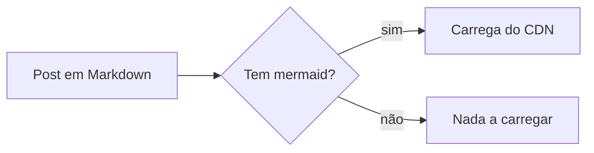

Parágrafo normal com um [link interno]({{ '/arquivo/' | relative_url }}), um [link externo](https://example.com), **negrito**, *itálico*, `código inline`, <mark>marcação destacada</mark> e um atalho <kbd>Ctrl</kbd> + <kbd>Alt</kbd> + <kbd>Del</kbd>. Notas de rodapé também funcionam.[^1]

## Subtítulo de seção

Um texto mais longo para ver o ritmo da leitura. A ideia é que o corpo tenha linha confortável, coluna estreita o bastante pra não cansar e contraste suficiente pra ler à noite sem forçar a vista.

### Listas

- Item simples
- Item com [link](https://example.com)
- Item com sublista
  - Sub-item
  - Outro sub-item

1. Primeiro passo
2. Segundo passo
3. Terceiro passo

### Citação e avisos

> Uma citação comum fica em itálico, com a barra azul à esquerda.

> **Nota:** use `{: .note}` na linha logo abaixo de uma citação pra virar aviso.
{: .note}

> **Dica:** `{: .tip}` usa a lâmpada do Windows 98.
{: .tip}

> **Atenção:** `{: .warn}` é pro que pode dar errado.
{: .warn}

## Mídia

<figure>
  
  <figcaption>Figura com legenda (HTML direto no Markdown).</figcaption>
</figure>



## Links




## Código

```js
// comentário
function sorteia(lista) {
  const i = Math.floor(Math.random() * lista.length);
  return lista[i] ?? "nada";
}
```

Todo bloco de código ganha uma barra com a linguagem e o botão "Copiar".



Diagramas Mermaid (bloco de código com a linguagem `mermaid`) só carregam a biblioteca se a página tiver algum.

## Matemática

Fórmula em linha: $$ E = mc^2 $$ no meio da frase. Em bloco, com linhas em branco em volta:

$$
\int_0^\infty e^{-x^2}\,dx = \frac{\sqrt{\pi}}{2}
$$

O KaTeX também só carrega quando há fórmula.

## Imagem de título

No front matter, `image:` mostra a imagem sob a faixa do título; `image_caption:` põe a legenda. Com `hero: banner` a imagem vira o fundo da faixa (a legenda vira um crédito no canto):

```yaml
image: /assets/img/estilos-exemplo.jpg
image_alt: "Descrição da imagem"
image_caption: "Foto: fulano"
hero: banner
```

## Tabela

| Jogo | Ano | Comando |
|---|---|---|
| Doom | 1993 | `DOOM` |
| Duke Nukem 3D | 1996 | `DUKE` |
| Xargon | 1994 | `XARGON` |

<details>
<summary>Detalhes recolhíveis</summary>

Conteúdo escondido até clicar.

</details>

---

Último parágrafo depois de um separador.

[^1]: Uma nota de rodapé de exemplo.
