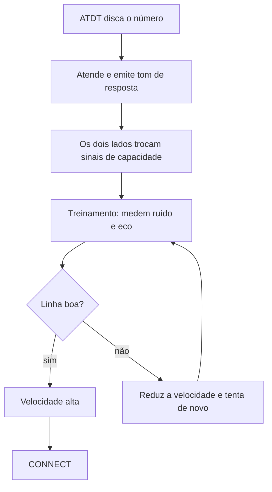
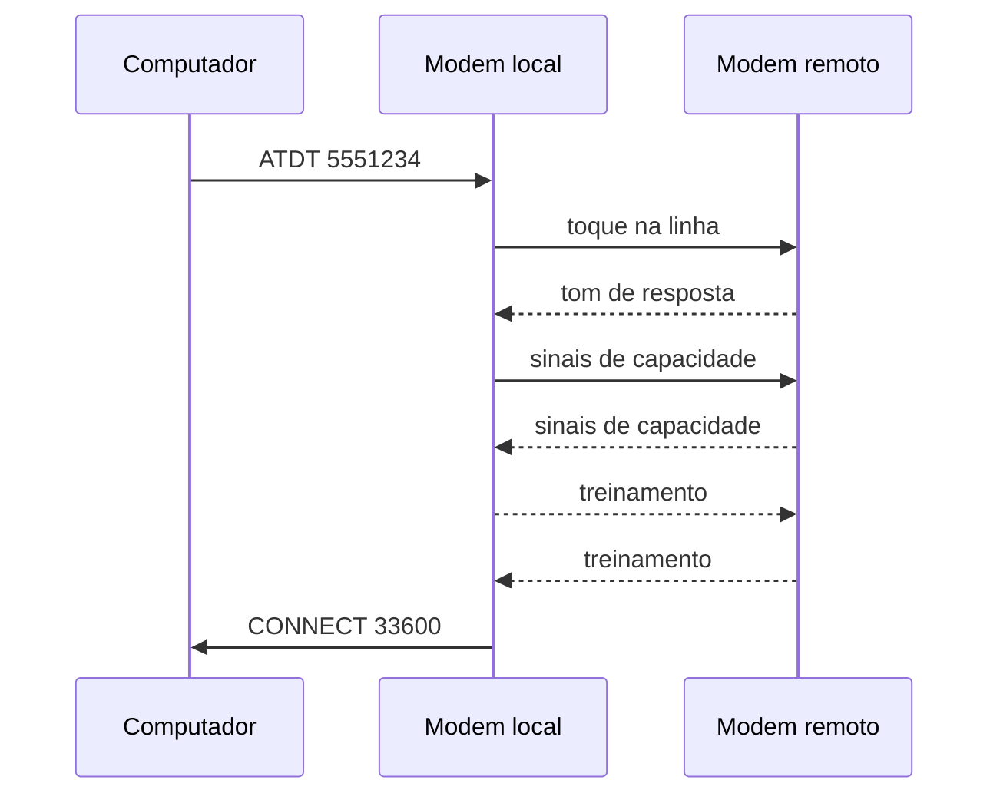

O chiado do modem não era enfeite. Era a conversa entre dois aparelhos que precisavam descobrir, no escuro, o que a linha telefônica aguentava.

## O problema: uma linha feita para voz

A rede telefônica filtrava tudo fora de uns 300 Hz a 3400 Hz. Para o modem, isso significava um canal estreito e barulhento, e dados tinham de caber dentro dele.

O truque era transformar bits em tons: o modem modulava o sinal e o outro lado demodulava. Daí o nome, **mo**dulador/**dem**odulador.[^1]

## O limite que ninguém passa

Claude Shannon mostrou que a capacidade máxima de um canal depende da largura de banda e da relação sinal-ruído:

$$
C = B \log_2\left(1 + \frac{S}{N}\right)
$$

Com $$B = 3100$$ Hz e uma relação de 30 dB (ou seja, $$S/N = 10^3$$), dá cerca de 31 kbit/s. Foi quase exatamente onde os modems analógicos chegaram. Não por acaso.

> O 56k só foi possível porque a ponta do provedor era digital. Só o trecho até a sua casa continuava analógico.
{: .note}

## Uma linha do tempo curta

| Padrão | Ano aprox. | Velocidade | Observação |
|--------|-----------:|-----------:|------------|
| Bell 103 | 1962 | 300 bit/s | FSK simples |
| V.22bis | 1984 | 2.400 bit/s | QAM |
| V.32bis | 1991 | 14.400 bit/s | cancelamento de eco |
| V.34 | 1994-96 | 28.800 a 33.600 bit/s | perto do limite de Shannon |
| V.90 | 1998 | 56.000 bit/s (só recebendo) | provedor digital |

## O aperto de mão



Em sequência de mensagens, a conversa lembra um protocolo qualquer:



## Brincando com os tons

Em Bell 103, um bit era um de dois tons. Em JavaScript dá para escolher a frequência de cada bit:

```js
// Bell 103, lado que origina a chamada
const FREQ = { 0: 1070, 1: 1270 }; // Hz

function tonsDoByte(byte) {
  return [...byte.toString(2).padStart(8, "0")].map((b) => FREQ[b]);
}

console.log(tonsDoByte(65)); // 'A'
```

E em Python, gerando o áudio de verdade num arquivo WAV:

```python
import math, struct, wave

RATE = 8000
def tom(freq, dur=1/300):
    n = int(RATE * dur)
    return [int(32767 * 0.5 * math.sin(2 * math.pi * freq * i / RATE)) for i in range(n)]

with wave.open("a.wav", "wb") as w:
    w.setnchannels(1); w.setsampwidth(2); w.setframerate(RATE)
    for freq in [1070, 1270, 1070, 1070, 1070, 1070, 1070, 1270]:  # 'A' = 01000001
        w.writeframes(b"".join(struct.pack("<h", s) for s in tom(freq)))
```

Em Linux, o jeito clássico de falar com o modem era mandar comandos AT direto à porta serial:

```bash
stty -F /dev/ttyS0 115200 raw
echo -e "ATZ\r" > /dev/ttyS0
echo -e "ATDT5551234\r" > /dev/ttyS0
```

Uma mudança comum era desligar o alto-falante para a casa dormir. Na string de inicialização:

```diff
  ATZ
- ATM1
+ ATM0
  ATDT5551234
```

E um perfil de modem, imaginário, em JSON:

```json
{
  "porta": "/dev/ttyS0",
  "baud": 115200,
  "init": ["ATZ", "ATM0"],
  "discar": "ATDT5551234",
  "tentativas": 3
}
```

> Os exemplos acima são ilustrativos. Em linhas de verdade, o treinamento muda tudo.
{: .tip}

<details markdown="1">
<summary>Por que o chiado terminava?</summary>

Depois do treinamento, os dois lados já sabiam o que a linha aguentava. Muitos modems silenciavam o alto-falante assim que a conexão se firmava.

</details>

> Não tente discar de verdade um número aleatório para testar isto.
{: .warn}

[^1]: Em português o "modem" ficou assim mesmo, sem tradução.
